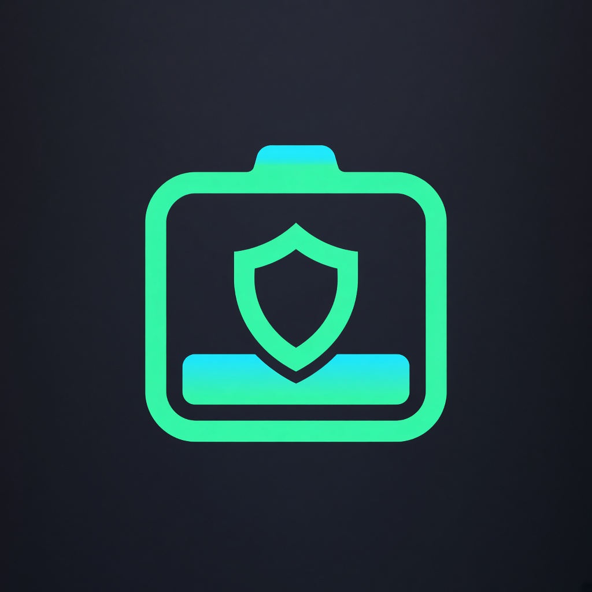

# Pin Thủ

[English](README.md) · [简体中文](README.zh-Hans.md) · **Tiếng Việt**

<p align="center">
  
</p>

Ứng dụng theo dõi pin và sạc trên iPhone, dựng trên private API của Apple. Pin Thủ đọc cảm biến quản lý nguồn của chính máy — cùng hệ iOS dùng để điều khiển sạc — rồi hiện bộ sạc đang giao bao nhiêu, bao nhiêu tới cell, phần còn lại đi đâu (tải + tổn hao), và từng cảm biến nhiệt đang làm gì trong lúc đó.

Fork từ [MiniWatts](https://github.com/ResistanceTo/MiniWatts), giao diện tiếng Việt, tên hiển thị **Pin Thủ**.

| Công suất | Nhiệt | Adapter | Lịch sử |
|:-:|:-:|:-:|:-:|
|  |  |  |  |

> **Chỉ sideload.** Private API nên không bao giờ lên App Store — bạn tự ký và cài. Không có mã mạng: mọi thứ đọc được đều ở lại trên máy.

## Cài đặt

### Build từ mã nguồn (fork này)

Cần Xcode 26+, iPhone iOS 17 trở lên:

```bash
TEAM_ID=ABCDE12345 ./scripts/build-ipa.sh signed
```

Rồi cài bằng Xcode, Sideloadly, AltStore hoặc SideStore.

### Bản upstream (MiniWatts)

Có thể tải `MiniWatts-unsigned.ipa` từ
[Releases của MiniWatts gốc](https://github.com/ResistanceTo/MiniWatts/releases)
rồi tự ký bằng Apple ID — [Sideloadly](https://sideloadly.io), [AltStore](https://altstore.io),
[SideStore](https://sidestore.io) hoặc Xcode. Apple ID miễn phí dùng được; app hết hạn sau bảy ngày và bạn ký lại.

Hoặc thêm nguồn SideStore / AltStore (kể cả SideStore trong LiveContainer):

```
https://github.com/ResistanceTo/MiniWatts/releases/latest/download/apps.json
```

LiveContainer không chạy được app extension, nên cài trong đó sẽ không có widget và Live Activity.

Pin Thủ có widget Màn hình chính / Màn hình khóa và Live Activity khi sạc. Extension widget chiếm thêm một App ID khi ký — Apple ID miễn phí được mười ID/tuần — và nếu công cụ ký gỡ extension thì widget cũng mất.

## Việc app không làm được

Tên cảm biến, thang đo, thậm chí cảm biến có tồn tại hay không đều khác theo model iPhone, và không có tài liệu chính thức. Bản gốc được viết và kiểm trên iPhone Air; trên model khác một đọc số có thể thiếu hoặc mang nghĩa khác với tên. Giá trị bất khả thi — ví dụ IC sạc −9199 °C mà người dùng từng gặp — bị ẩn, nhưng giá trị sai mà vẫn trông hợp lý thì không bắt được. Thấy gì lệch, hãy báo kèm định danh model.

Chỉ những gì iOS thật sự giao cho app trong sandbox. Sức khỏe pin và số chu kỳ bị lọc khỏi registry; pin phụ kiện (Watch, AirPods) trả về rỗng; sạc không dây không lộ dòng vào, nên MagSafe chỉ thấy phần tới cell; công suất xả không có cảm biến và được ước từ tốc độ %; tạm dừng sạc chỉ suy luận được và được gắn nhãn `inferred`.

Widget làm mới khi iOS cho phép, thường mỗi 15–60 phút, và mỗi cái ghi rõ số lấy lúc nào. Live Activity chỉ cập nhật khi Pin Thủ đang chạy; app bị treo thì đọc số hiện là tạm dừng. Cả hai đều không thể cập nhật mỗi giây — ngân sách đó thuộc hệ thống.

Muốn số vẫn chạy mỗi giây khi đang dùng app khác: mở **đồng hồ nổi** trong Cài đặt — cửa sổ Picture in Picture giữ Pin Thủ sống, nên cũng ghi lần sạc khi màn hình khóa. Tốn pin hơn, tự đóng khi xong. Không phát âm thanh; PiP vốn là tính năng video, đó là lý do app khai báo phát audio.

## Build

Xcode 26 trở lên, deployment iOS 17, không phụ thuộc bên thứ ba.

```bash
./scripts/build-ipa.sh                             # không ký
TEAM_ID=ABCDE12345 ./scripts/build-ipa.sh signed   # ký cho máy của bạn
```

[`CLAUDE.md`](CLAUDE.md) là sổ kỹ thuật (tiếng Anh): API nào sandbox chặn, từng cảm biến hóa ra là gì, và các bẫy Swift 6 isolation dự án đã dính.

## Đồng bộ với upstream

```bash
git fetch upstream
git merge upstream/master
```

## Giấy phép

Apache 2.0 — xem [LICENSE](LICENSE). Cách đọc PMU dựa trên
[ios-charging-monitor](https://github.com/gregsramblings/ios-charging-monitor) (MIT);
`BatteryCenterBridge` nợ hai chi tiết từ [Batsie](https://github.com/leptos-null/Batsie).
Cả hai được ghi trong [NOTICE](NOTICE).

Private API có thể đổi hoặc biến mất ở mọi bản cập nhật iOS.
